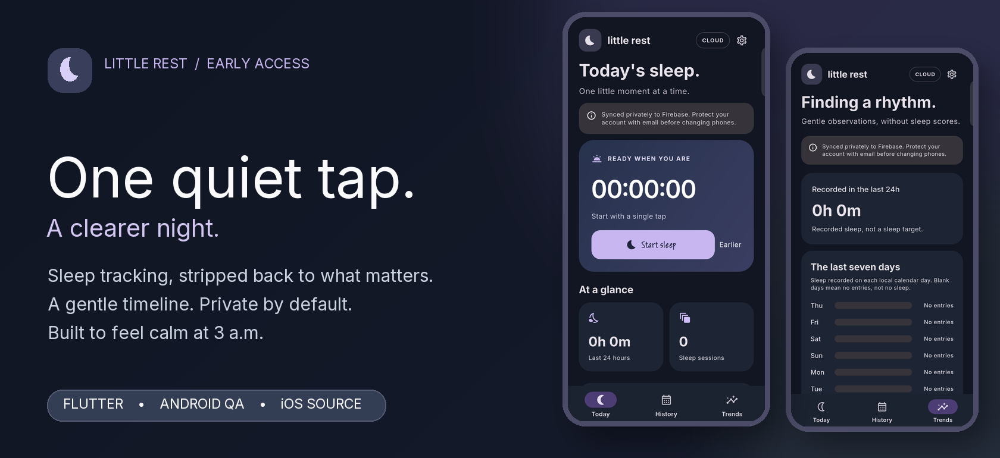
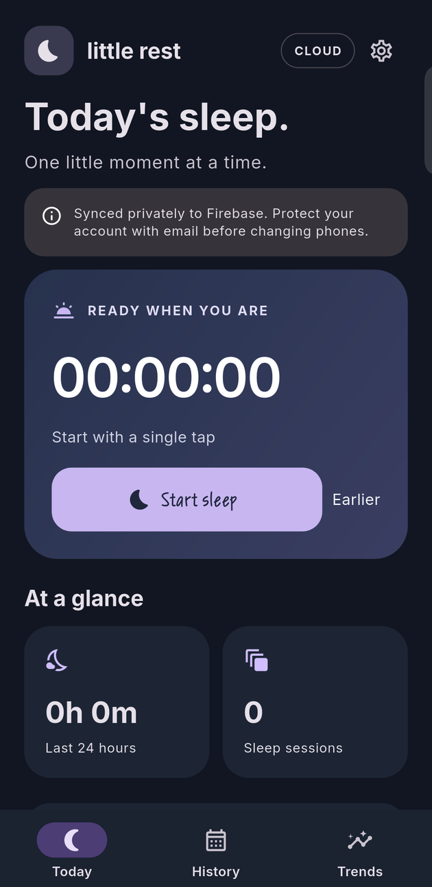
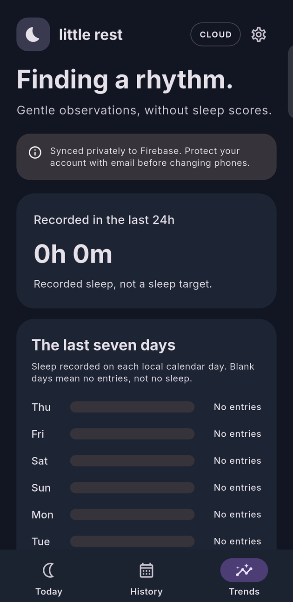
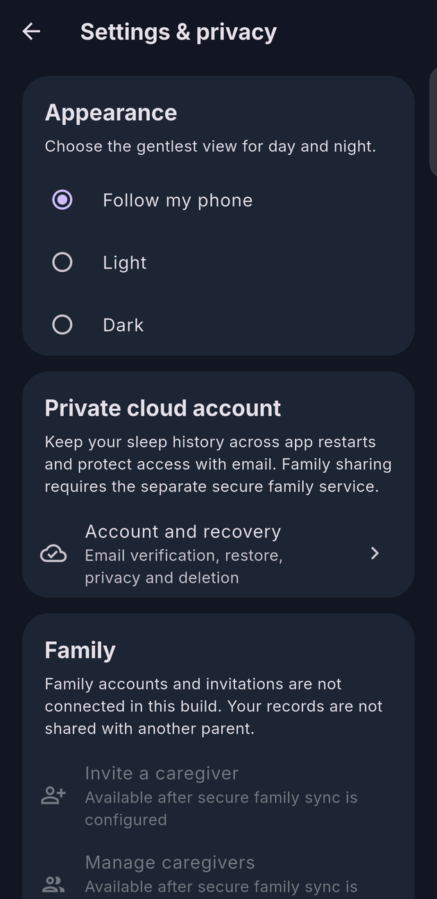
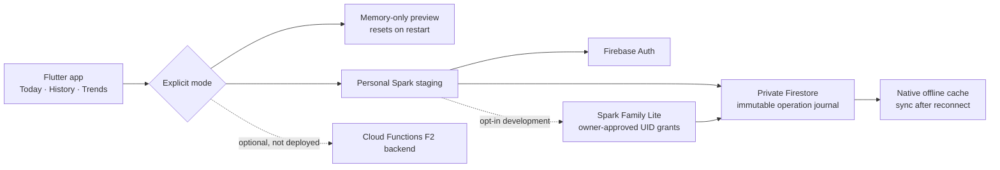

<div align="center">



# Little Rest

**A calmer way to follow the little moments between naps.**

A thoughtfully quiet sleep tracker: one-tap timing, a clear history, gentle trends, and a private journal that can catch up after a night offline.

**Flutter · Material 3 · Android + iOS source · Firebase**

**Family Lite candidate: 0.2.0-beta.2 (development)** · [Changelog](CHANGELOG.md) · [Family Lite notes](docs/releases/0.2.0-beta.2.md)

[See the app](#the-experience) · [Try on Android](#try-it) · [How it works](#how-it-works) · [Development](#development)

</div>

> [!IMPORTANT]
> **Private preview, not a public release.** Use **synthetic sleep data only**. Spark Family Lite Android beta.2 is available for QA and has passed two-account emulator security/sync tests. An installable iPhone Home Screen PWA is being validated in [PR #33](https://github.com/analienx/baby-sleep-tracker/pull/33), and live two-device iPhone/Android acceptance is pending. This is not an App Store release.

## The experience

<table>
  <tr>
    <td align="center" width="33%"></td>
    <td align="center" width="33%"></td>
    <td align="center" width="33%"></td>
  </tr>
  <tr>
    <td align="center"><strong>One-tap Today</strong></td>
    <td align="center"><strong>Honest Trends</strong></td>
    <td align="center"><strong>Private controls</strong></td>
  </tr>
</table>

<sub>Actual Vivo Android 16 staging-app captures, taken with an empty journal; status and gesture bars cropped out. No sleep records, email addresses or real child data appear. These show an active pre-release branch, not production approval.</sub>

### Made for moments when you're running on little sleep

- **One clear action.** Start and end a sleep session without navigating through forms. Correct the timeline when you miss a tap.
- **Useful at a glance.** Recent sleep, number of sessions, history and trends, without claiming clinical or predictive accuracy.
- **Designed for real nights.** Light and dark themes, larger tap targets, explicit offline/sync status and intentionally restrained colors.
- **Private by default.** A separate, opt-in Firebase Spark mode stores an immutable journal under your own authenticated user ID. The ordinary preview never silently uploads data.
- **Own your information.** JSON/CSV export and staged account-recovery/deletion flows are implemented, with important security limitations documented below.

## Try it

| Platform | Current path | Availability |
| --- | --- | --- |
| **Android** | Download the private signed **staging APK** from the [latest successful **Spark staging Android** run](https://github.com/analienx/baby-sleep-tracker/actions/workflows/spark-staging-android.yml) under **Artifacts**, unzip and install `app-debug.apk` | QA only · artifact expires after 14 days |
| **Android developers** | On the [feature branch](https://github.com/analienx/baby-sleep-tracker/tree/feat/spark-personal-cloud-light-ui), use `python scripts/staging_deploy.py doctor` and `deploy` after owner-managed secrets are configured | GitHub runner build + ADB deploy |
| **iPhone (PWA)** | **[Open Little Rest on iPhone](https://little-rest-ios-qa.web.app)** in Safari → Share → Add to Home Screen. [Install/privacy guide](docs/pwa/IPHONE_INSTALL.md) | **Live Spark QA — Chrome mobile smoke + restart recovery passed; physical Safari QA pending** |

Android may require **Install unknown apps** permission for the browser or file manager opening the APK. It installs as `com.analienx.baby_sleep_tracker.staging` and does not overwrite the memory-only preview. No Google Play / App Store listing exists yet.

**Spark Family Lite (development):** each parent has a separate email-verified Firebase account. The owner approves the other parent's UID, who joins the same append-only journal without sharing a password. Firestore Security Rules enforce membership and revocation **on the free Spark project**—no Cloud Functions required. [Setup, limitations and security gates](docs/SPARK_FAMILY_LITE.md). The Family Lite signed APK is available for synthetic QA under [beta.2 staging build #39746741570](https://github.com/analienx/baby-sleep-tracker/actions/runs/39746741570). Do not treat this as a production release.

## How it works



| Mode | Data durability | Sharing | Status |
| --- | --- | --- | --- |
| **Preview** | In memory only; disappears at restart | None | UI smoke-tested |
| **Personal staging** | Firebase Auth + offline Firestore journal | One account, not a household | Emulator CI and Android install/launch verified; physical data QA pending |
| **Spark Family Lite** | Shared Firestore journal, immutable revisions, account-scoped grants | Owner-approved single caregiver; no billing | Implementation and security CI in PR #32; live QA pending |
| **F2 Cloud Functions** | Admin SDK managed household journal | Full callable invites/admin cleanup | Optional alternative, not deployed |

The app uses **Flutter/Dart, Riverpod, go_router, Firebase Auth and Cloud Firestore**. No background timer is kept alive to estimate sleep time: durations derive from stored timestamps. Conflicting edits are modeled as operations, not silent last-write-wins replacement.

## Development

The currently testable app lives on the [Spark/premium feature branch](https://github.com/analienx/baby-sleep-tracker/tree/feat/spark-personal-cloud-light-ui). For a memory-only preview:

```bash
git checkout feat/spark-personal-cloud-light-ui
flutter pub get --enforce-lockfile
flutter run
```

For private Spark staging, follow the [staging setup, security rules and deployment runbook](docs/SPARK_PERSONAL_STAGING.md). **Do not** copy the operator's Firebase configuration, signing keys or private exports into this public repository.

```bash
flutter analyze
flutter test
python -m unittest discover -s scripts -p 'test_staging_deploy.py' -v
```

CI includes Flutter checks, visual goldens, Firebase security rules, personal/family emulator tests, and signed Android staging builds. The screenshot gallery uses **real rendered staging-app captures** verified to show no child records, not the test goldens (whose deterministic test font produces block glyphs).

## Trust, safety & release status

Little Rest is for recording sleep, **not medical guidance**. The live Spark test project retains owner-only personal rules until a reviewed Family Lite rollout. In Family Lite, Firestore Rules enforce owner-issued grants and an irreversible deletion fence; offline devices can still retain previously cached or exported records. Physical offline/recovery/deletion testing, App Check, independent privacy/security review, iPhone QA and release signoff remain open. The legacy F2 callable family mode would require Blaze; **Spark Family Lite does not**, and we will not replace it with insecure self-editable membership.

**Font credit:** The app bundles [Inter](https://github.com/rsms/inter) under the [SIL Open Font License](assets/fonts/OFL.txt). Screenshot compositions use actual emulator pixels, not generated interfaces.

**Engineering and review notes:** [Full developer guide](README_DEVELOPER.md) · [Architecture decision](docs/ADR-0001-flutter-firebase.md) · [F1 correctness](docs/F1_ALGORITHMS.md) · [F2 security](docs/F2_IMPLEMENTATION.md) · [F3 review](docs/F3_REVIEW.md) · [Physical QA checklist](docs/PHYSICAL_QA.md) · [Issues and gates](https://github.com/analienx/baby-sleep-tracker/issues).

---

<div align="center"><sub>Made for tired hands and quieter nights. · Pre-release · No real infant data in repository assets.</sub></div>
