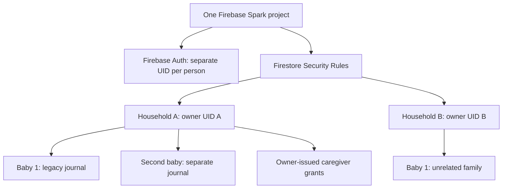

# Little Rest — multiple accounts, multiple babies, one Spark project

**State:** draft implementation in [PR #34](https://github.com/analienx/baby-sleep-tracker/pull/34). Existing personal/Family Lite staging remains usable. **Do not use real child records until security and two-device acceptance.**

## The model

A household is owned by a verified Firebase account. Its owner can grant a second verified Firebase UID access. Each caregiver uses their own identity and each operation keeps the actual actor UID. The **same household's grants** permit collaboration on all that household's babies; a stranger's UID grants no access.

## Firestore paths

| Resource | Scope | Permission |
| --- | --- | --- |
| `personalSleep/{ownerUid}/operations/{operationId}` | Original Baby 1 | Existing owner and authorized caregiver journal; preserved without migration |
| `personalSleep/{ownerUid}/babies/primary` | Optional Baby 1 custom name | Owner creates/renames; caregiver reads |
| `personalSleep/{ownerUid}/babies/{randomBabyId}` | Named additional baby | Owner creates/renames; caregiver reads |
| `personalSleep/{ownerUid}/babies/{randomBabyId}/operations/{operationId}` | One other baby's immutable journal | Owner or verified grant holder creates immutable actor-authenticated ops; never edited in place |
| `personalSleep/{ownerUid}/caregivers/{caregiverUid}` | Household-wide explicit grant | Owner only creates/revokes, no self-enrollment |
| `personalSleep/{ownerUid}/sharing/state` | Permanent shared marker | Prevents old personal-only clients erasing shared journal |
| `personalSleep/{ownerUid}/control/state` | Irreversible deletion fence | Blocks new writes before client-side verified account erasure |

**No schema rewrite of old operations, no background job, and no new Firebase project per child.**

## User experience

- Today, History and Trends have a persistent child selector at the top, with the **selected name visible before any sleep action**.
- The owner can add or rename a baby's profile. The caregiver can select any authorized child, record sleep, and see the same history.
- Switching children re-creates the relevant Firestore repository and subscriptions; the previous child's sessions never form part of the next child's projection. Both children can have concurrent in-progress sessions.
- Selection is stored with both the **signed-in actor UID** and **household owner UID**, so switching accounts does not inherit the previous user's baby.
- On cold start, a non-primary saved selection must be verified online before writes are enabled. If it cannot be verified, the UI **blocks sleep entry** rather than writing accidentally into Baby 1. Explicit recovery into the original journal is available.
- Baby profiles are not deletable from ordinary UI because deleting a child could silently orphan years of sleep history; full household erasure is separately fenced and verified.

## Acceptance gates

1. Keep all pre-upgrade sleep operations available as Baby 1 after upgrading and after re-sign-in.
2. Baby 1 and Baby 2 histories/active timers never mix, and selection remains visible when switching Today / History / Trends.
3. Owner can create/rename, caregiver cannot; unrelated households cannot read any child or metadata.
4. Both caregivers see new baby profiles, and child-specific recorded operations sync with the true actor identity.
5. Saved selections do not cross household/account boundaries; failed cold-start profile verification never silently falls back to the wrong baby.
6. Revocation denies reads and writes across **all** babies, including offline pending writes after reconnect.
7. Account deletion first creates the irreversible fence, then removes caregiver grants, each baby's operations and profile, finally legacy operations and Auth. No stale account should retain server-authorized access. The control/state fence document intentionally remains, and sharing/state remains only if sharing was ever enabled: Rules make both client-undeletable, they contain only flags/timestamps (no sleep or personal data), and they stay keyed by the deleted UID so no other account can reuse that journal path.
8. On Android and iPhone PWA: synthetic two-account, two-baby QA with start/stop, offline/reconnect, export, cold start and accessibility before G2/G3 approval.

## Scope boundaries

The UI does not yet support merging babies, deleting a baby alone, bulk migration of records to another baby, global family discovery, or server-enforced hard baby-count limits. None is necessary for v1, and each has nontrivial security/data-loss consequences.

Spark has a shared project-level quota: many independent families are supported by Rules and Auth but scale is **not unlimited**. Monitor security rule lookups and read/write volumes, then consider paid capacity only if needed. 
